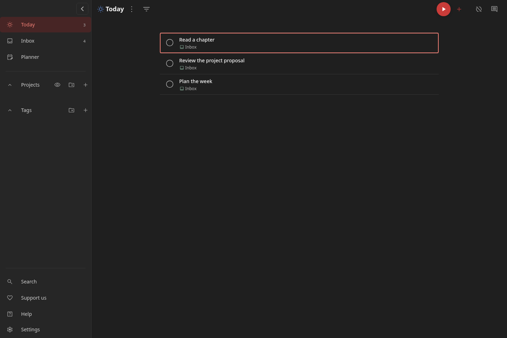

# Todoist Dark for Super Productivity

A small, standalone CSS theme that brings Todoist's dark-mode look to
[Super Productivity](https://super-productivity.com/). Charcoal canvas, a lighter
sidebar, coral accents, flat task rows and round completion controls—without
replacing the app or changing how tasks work.



## Install

For **Super Productivity 19.2.0 and newer**:

**[Download todoist-dark.css from the latest release](https://github.com/Hendrik240298/superprod-theme/releases/latest/download/todoist-dark.css)**

1. Open **Settings → General → Appearance**.
2. Set **Dark Mode → Dark**. A custom theme cannot request dark mode automatically.
3. Under **Theme**, click **Install theme** and choose [`todoist-dark.css`](todoist-dark.css).
4. Select **Todoist Dark** if it is not already selected.

That's it. No build, plugin, network assets or application restart needed. The
theme is stored locally on this device, separately from your tasks.

For the closest result, disable any project/Today wallpaper and use the normal
horizontal header. Existing sidebar size and app-feature preferences are retained.

**Update:** install the updated CSS file again and select the updated entry. If the
picker retains an older copy, remove it via the trash icon in the theme dropdown.

**Undo:** select **Default** or another theme. To uninstall, open the theme dropdown
and use the trash icon beside **Todoist Dark**. Tasks and app preferences stay put.

If an existing Electron `styles.css` is installed, it can conflict with this theme.
Back it up and disable it before comparing; this project never modifies that file.

## What changes

- `#1f1f1f` main canvas, `#262626` sidebar, `#282828` raised surfaces.
- Soft hairlines instead of card shadows; an approximately 800px desktop task column.
- Native-system UI fonts, 14px task text, compact navigation and restrained rounding.
- Coral-red actions and navigation selection; darker filled buttons for readable white labels.
- Round **existing** completion controls, keeping their labels, hit areas, timer indicator and check animation.
- Dark menus, dialogs, form surfaces, task details, notes, calendar and scrollbar tokens.
- Distinct hover, detail-open, running, multi-select and keyboard-focus states.
- Larger minimum row height on small screens; reduced-motion support.

Light mode is intentionally unchanged. There are no scripts, downloaded fonts,
logos, hidden controls or changes to task data.

## Kanban and limits

The companion [superprod-kanban](https://github.com/Hendrik240298/superprod-kanban) plugin already uses Super Productivity's shared
colour and font variables. Its background, cards, borders, text and accent can
therefore follow this palette through the app's supported iframe theme bridge.
An app stylesheet **cannot reach inside an iframe**: its card geometry and custom
controls remain the plugin's responsibility. No plugin files were changed here.

This is an **unofficial visual adaptation**, not a pixel-perfect Todoist replica.
Super Productivity retains its own header, icons, navigation, time tracking and
interaction model. Individually coloured tags/project icons are not recoloured.
Internal component selectors can change with app updates; public theme tokens
are preferred wherever possible.

## Verification

- Designed against the **19.2.0** source and public theme contract.
- Accepted by the original **19.2.0 CSS validator**, with no errors or contract warnings.
- **12 offline tests** cover CSS parsing, self-contained assets, palette, contrast,
  state isolation, round controls, focus, mobile sizing, light mode and rollback.
- Real-app smoke test passed on the public **19.3.1WB** web build in an isolated
  browser: theme upload, reload persistence, task creation/completion, context menu,
  narrow layout, mobile drawer, theme removal and retained tasks after reload.
- Screenshots are from disposable test tasks, not personal task data.

The installed Electron **19.2.0** app was not modified or launched for this test.
Desktop rendering, native window controls, other plugins, and all app screens still
need hands-on verification. Core text/action contrast is tested; this is not a
full accessibility audit.

### Run tests

From this project's code directory, with Python 3 and a Chromium-capable host:

```sh
python3 -m venv .venv
.venv/bin/pip install -r requirements-dev.txt
.venv/bin/python -m playwright install chromium
.venv/bin/python -m unittest discover -s tests -v
```

The offline suite makes no network requests. Separately, the opt-in smoke test
loads the public app in a new ephemeral browser profile:

```sh
.venv/bin/python tests/app_smoke.py
```

It never connects to your existing browser or desktop app. Screenshots go to
Git-ignored `test-results/`. Use `SP_APP_URL` to test a separately served build.

GitHub Actions runs the offline suite on pushes and pull requests. Version tags
such as `v0.1.0` publish the CSS as a release asset only after those tests pass.

## Customise

Edit the private `--td-*` tokens near the top of `todoist-dark.css`, then reinstall
the file. All selectors are scoped to `body.isDarkTheme`, so selecting another
theme cleanly removes the visual changes.

References and implementation boundaries: [docs/REFERENCES.md](docs/REFERENCES.md).
Licensed under [MIT](LICENSE). Not affiliated with or endorsed by Doist or the
Super Productivity maintainers.
